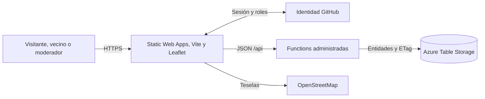

# SJL Alerta

Prototipo académico para registrar incidentes ficticios, moderarlos y consultar aprobados por sector de San Juan de Lurigancho. El mapa cuenta los reportes disponibles y usa ubicaciones aproximadas. El prototipo no envía avisos a autoridades.

## Windows PowerShell y VS Code

Descomprime el ZIP. Abre la carpeta que contiene este README con **Archivo → Abrir carpeta**. Instala Node.js 22 y Git. Abre dos terminales PowerShell de VS Code.

Primera terminal:

```powershell
npm.cmd ci --prefix api
npm.cmd test --prefix api
node .\dev\server.js
```

Segunda terminal:

```powershell
npm.cmd ci --prefix web
npm.cmd run dev --prefix web
```

Abre http://127.0.0.1:5173. Registra como Demo vecino, aprueba como Demo moderador y comprueba la publicación y los filtros como Demo visitante. Los reportes locales viven en memoria. El servicio en Azure usa una tabla inicialmente vacía.

## Pregunta 3



- La interfaz consume el API y dibuja el mapa. Solo el rol moderador tiene bandeja y decisiones.
- Azure Static Web Apps controla los roles en el gateway y Functions valida el principal recibido de ese gateway. Conserva las Functions administradas detrás de Static Web Apps si utilizas este esquema.
- El API valida sector, categoría y franja y guarda únicamente los campos del catálogo. Publica aprobados y usa actualización condicional con ETag para devolver 409 en decisiones concurrentes.
- GET /api/health comprueba la lectura de la tabla. Cuando el almacenamiento falla devuelve 503.

| Fase | Herramienta y control |
|---|---|
| Plan | Jira. Criterios de permisos, datos públicos y estados. |
| Code | GitHub. Rama test, PR y revisión de cambios. |
| Build | Node.js 22, npm ci y Vite. Instalación según lockfiles y verificación de reglas de Azure. |
| Test | node:test, Semgrep, npm audit y Gitleaks. Validación de permisos, estados, código, dependencias y secretos. |
| Release | GitHub Actions. Resultado de CI por commit y paso a main mediante PR. |
| Deploy | Azure Static Web Apps. Publica solo desde main tras CI. Ajustes privados en Azure y GitHub. |
| Operate | Portal de Azure. Roles por invitación, revisión de acceso y consumo. |
| Monitor | Comprobación HTTPS tras el deploy y endpoint de salud. |

Sustenta shift-left vinculando el criterio de moderación de Jira con la prueba que obtiene 403 y con el job de CI que la ejecuta antes del despliegue.

## Pregunta 4

1. Crea un repositorio vacío en GitHub y publica la base.

```powershell
git init -b main
git add .
git commit -m "chore: incorporar SJL Alerta y el pipeline"
git remote add origin 'https://github.com/TU_USUARIO/sjl-alerta.git'
git push -u origin main
git switch -c test
```

2. Selecciona tu suscripción **Azure for Students** en Azure Portal. Crea un grupo de recursos, una cuenta StorageV2 LRS y la tabla `reports` en Storage Browser.
3. Crea una **Static Web App** en plan Free con origen **Other / Otro**. En la configuración del backend agrega la cadena Storage como `TABLE_CONNECTION_STRING`. En GitHub crea el secreto `AZURE_STATIC_WEB_APPS_API_TOKEN` con el token de la Static Web App y la variable `SWA_URL` con la URL HTTPS sin barra final.
4. Desde **Role management**, invita a la cuenta GitHub de moderación con el rol `moderador` y acepta la invitación con esa cuenta.
5. Si tienes permisos de administración de Jira y GitHub, instala **GitHub for Atlassian** y selecciona solo el repositorio del proyecto. En Jira PP, copia una clave real y úsala en el commit y título del PR. Sustituye PP-12 por tu clave. Agrega primero al README tu resultado observado de la prueba local.

```powershell
git add README.md
git commit -m "PP-12 docs: registrar prueba local"
git push -u origin test
```

6. Abre el PR de test hacia main, espera a que pase CI y fusiónalo. El push a main vuelve a ejecutar CI y publica si existe SWA_URL. Comprueba en el ticket de Jira si aparece el PR en **Desarrollo**.
7. Comprueba el resultado desde PowerShell.

```powershell
$azure = 'https://TU-SITIO.azurestaticapps.net'
Invoke-RestMethod "$azure/api/health"
```

8. Ejecuta el flujo ficticio en Azure con una cuenta vecina, una moderadora y una ventana anónima. Adjunta en el informe las capturas del flujo, el PR, el run de CI y deploy, el SHA y la URL pública. Incluye el enlace al proyecto Jira para el docente.

Para crear el ZIP final desde el commit integrado, actualiza localmente main y ejecuta `git archive --format=zip --output=sjl-alerta-final.zip main`.
